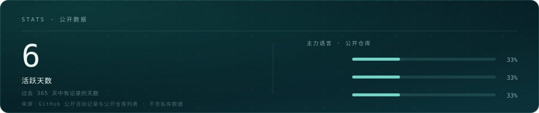

  <picture>
    <source media="(prefers-color-scheme: dark)" srcset="assets/banner-deep.svg">
    <source media="(prefers-color-scheme: light)" srcset="assets/banner-paper.svg">
    
  </picture>

## yabingwang

一个程序员。

日常是把需求拆小、把边界划清、把状态想全；剩下的时间用来把已经写对的东西写清楚。

  <picture>
    <source media="(prefers-color-scheme: dark)" srcset="assets/stats.svg">
    <source media="(prefers-color-scheme: light)" srcset="assets/stats-light.svg">
    
  </picture>
  <picture>
    <source media="(prefers-color-scheme: dark)" srcset="assets/heatmap.svg">
    <source media="(prefers-color-scheme: light)" srcset="assets/heatmap-light.svg">
    
  </picture>

  <picture>
    <source media="(prefers-color-scheme: dark)" srcset="assets/divider-deep.svg">
    <source media="(prefers-color-scheme: light)" srcset="assets/divider-paper.svg">
    
  </picture>

### 在意的事

- 命名要诚实，边界要明确。
- 出错时，应能一眼看出是哪一层。
- 复杂度不藏进抽象，也不交给「历史原因」。

### 长期

把手上的系统维护到不需要天天盯着它。

  <picture>
    <source media="(prefers-color-scheme: dark)" srcset="assets/divider-deep.svg">
    <source media="(prefers-color-scheme: light)" srcset="assets/divider-paper.svg">
    
  </picture>
  <picture>
    <source media="(prefers-color-scheme: dark)" srcset="assets/marquee-deep.svg">
    <source media="(prefers-color-scheme: light)" srcset="assets/marquee-paper.svg">
    
  </picture>
  <picture>
    <source media="(prefers-color-scheme: dark)" srcset="assets/status-deep.svg">
    <source media="(prefers-color-scheme: light)" srcset="assets/status-paper.svg">
    
  </picture>

这里只写结论，过程在代码里。
